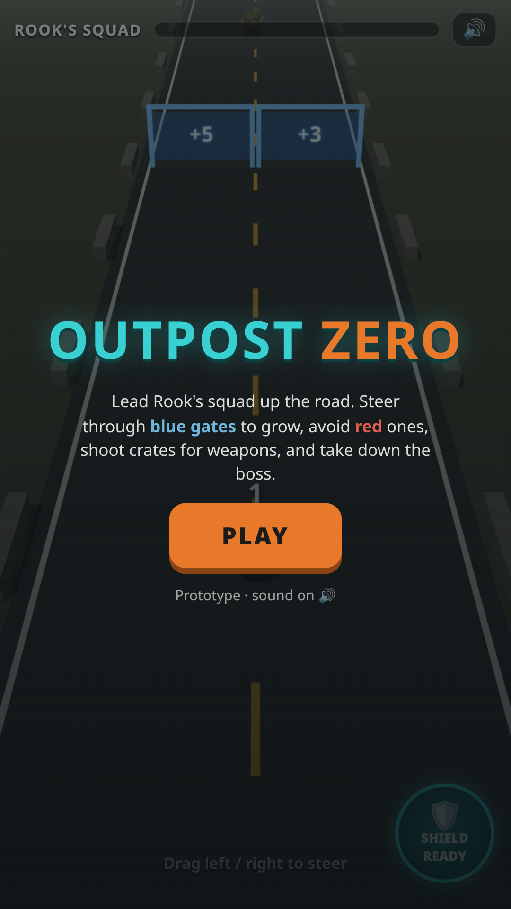

# Outpost Zero

A Last War-style squad runner. Steer Rook's squad up the road, grow through the gates, grab weapon crates, and take down the boss.

**Play the browser prototype:** [https://orazr.github.io/runner-game-/](https://orazr.github.io/runner-game-/)

Drag left or right to steer. The shield button is Rook's Shield Wall. Tap **Play** to start (that also turns sound on). Add `?demo` for an auto-steer attract mode.



## Open the Unity project

The Unity draft lives in [`unity/OutpostZero/`](unity/OutpostZero/) (editor version **2022.3.50f1**; Unity 6 should also open it). It has not been opened in the editor yet. All art is placeholder geometry built from code, and the main scene is generated on first open.

1. Install [Unity Hub](https://unity.com/download) and **Unity 2022.3 LTS**, with **Android Build Support** and/or **iOS Build Support** if you want device builds.
2. Unity Hub → **Add** → **Add project from disk** → select the `unity/OutpostZero` folder. The first import builds `Library/` and takes a few minutes.
3. The main scene is built automatically the first time the project opens. To rebuild it: menu **Outpost Zero → Build Main Scene**. That writes `Assets/Scenes/Main.unity`, wires the audio clips, adds the scene to Build Settings, and sets portrait orientation.
4. Open `Assets/Scenes/Main.unity`, set the Game view to a portrait size (for example 1080×1920), and press **Play**.

Controls in the editor: drag left/right with the mouse, or use the arrow keys / A and D. Space is Shield Wall.

Input uses the legacy Input Manager. If Unity 6 has **Project Settings → Player → Active Input Handling** set to "Input System Package (New)", switch it to **Both**.

Android and iOS build steps are in [`unity/OutpostZero/README.md`](unity/OutpostZero/README.md).

## Repo layout

| Path | Contents |
| --- | --- |
| `web/` | Playable build deployed to GitHub Pages (Three.js bundle, audio embedded). |
| `web-src/` | Prototype source. No `node_modules` in git. |
| `audio/` | Original synthesized audio: `wav/`, `ogg/`, `mp3/`. |
| `audio-src/synth.py` | Sound generator. |
| `unity/OutpostZero/` | Unity project. |
| `screenshots/` | Prototype screenshots (1080×1920). |

Rebuild the web bundle from `web-src/`:

```bash
npx esbuild src/main.js --bundle --minify --format=iife --target=es2020 --outfile=../web/game.js
```

Regenerate the wav files with `python3 audio-src/synth.py audio/wav` (needs numpy and scipy).
